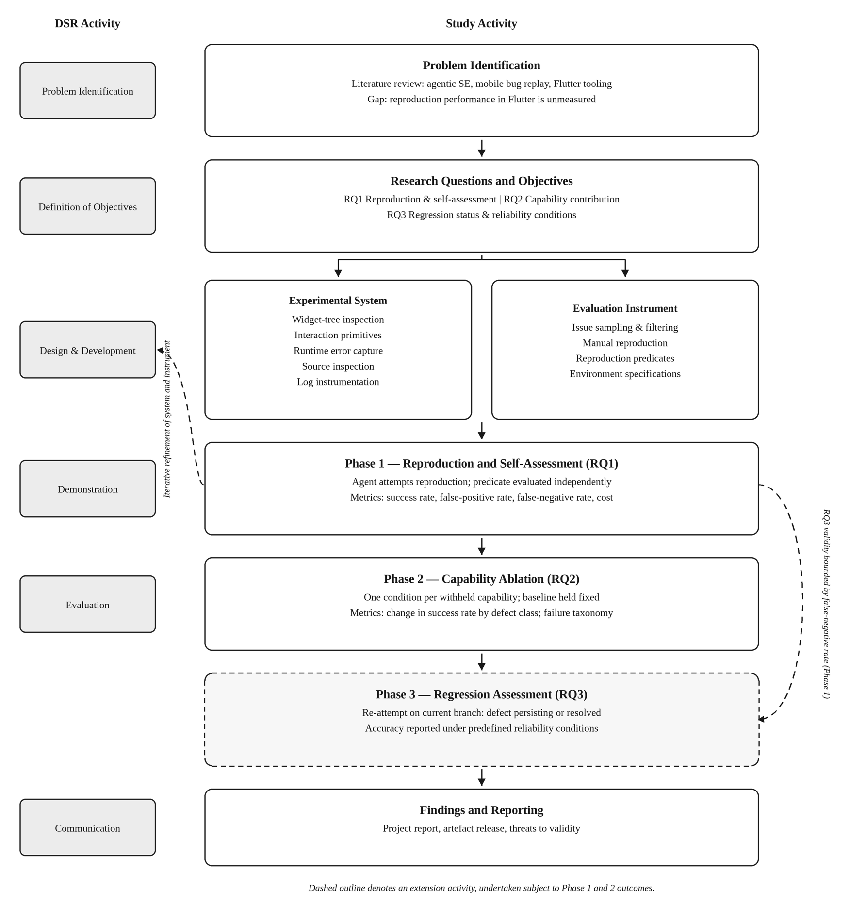
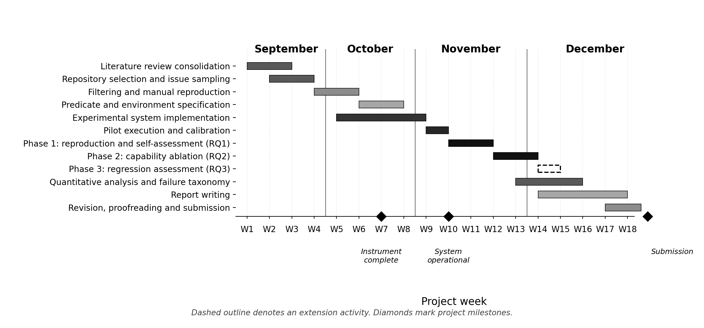

**Asia Pacific University of Technology & Innovation**

CT095-6-M-RMCE / CT087-3-M-RMCP

Research Methodology in Computing & Engineering

**Automated Bug Reproduction in Flutter Applications Using Large Language Model Agents:**

**Capability Requirements, Self-Verification, and Regression Assessment**

*Project Proposal\
Date: July 2026*

Student Name: Sukhrob Djumaev

Student ID: TP123152

Programme: MSc in Artificial Intelligence

# Abstract

Developers must reproduce a reported bug before they can debug it or begin a fix. Unlike repository-level repair benchmarks, this task has no hidden test suite to show whether reproduction was successful. This study examines whether large language model (LLM) agents can reproduce defects in running Flutter applications from tickets or reports and judge their own success accurately. Using Design Science Research, it will build and evaluate an experimental system with Flutter widget-tree inspection, user interaction, runtime-error capture, source inspection, and temporary log instrumentation through hot reload. A fixed set of manually verified Flutter bugs will provide independent reproduction predicates and evidence records. Controlled experiments will measure reproduction success, self-assessment accuracy, the effect of selected runtime capabilities, and regression-status classification accuracy. Quantitative results will include confidence intervals and will be supported by qualitative analysis of failed execution traces. The study will produce a reproducible evaluation instrument, evidence about the capabilities needed for Flutter bug reproduction, and reliability conditions for judging whether a reported bug still persists.

# Table of Contents

[List of figures [iv](#list-of-figures)](#list-of-figures)

[List of tables [iv](#list-of-tables)](#list-of-tables)

[List of abbreviations [iv](#list-of-abbreviations)](#list-of-abbreviations)

[1. Introduction [1](#section)](#section)

[2. Research Background [1](#research-background)](#research-background)

[2.1 Review Protocol [1](#review-protocol)](#review-protocol)

[2.2 Agentic Large Language Models in Software Engineering [2](#agentic-large-language-models-in-software-engineering)](#agentic-large-language-models-in-software-engineering)

[2.3 Automated Bug Reproduction in Mobile Applications [2](#automated-bug-reproduction-in-mobile-applications)](#automated-bug-reproduction-in-mobile-applications)

[2.4 Regression Identification and Fault Localisation [3](#section-2)](#section-2)

[2.5 The Flutter Ecosystem [3](#the-flutter-ecosystem)](#the-flutter-ecosystem)

[3. Problem Statement [3](#problem-statement)](#problem-statement)

[4. Research Questions [4](#research-questions)](#research-questions)

[5. Aim and Objectives [4](#aim-and-objectives)](#aim-and-objectives)

[6. Scope of the Research [5](#scope-of-the-research)](#scope-of-the-research)

[7. Significance of the Research [5](#significance-of-the-research)](#significance-of-the-research)

[7.1 Practical Significance [5](#practical-significance)](#practical-significance)

[7.2 Research Significance [5](#research-significance)](#research-significance)

[7.3 Wider Significance [6](#wider-significance)](#wider-significance)

[8. Research Methodology [6](#research-methodology)](#research-methodology)

[8.1 Overall Approach [6](#overall-approach)](#overall-approach)

[8.2 The Experimental System [8](#the-experimental-system)](#the-experimental-system)

[8.3 Evaluation Instrument [8](#evaluation-instrument)](#evaluation-instrument)

[8.4 Phase 1: Reproduction and Self-Assessment (RQ1) [9](#phase-1-reproduction-and-self-assessment-rq1)](#phase-1-reproduction-and-self-assessment-rq1)

[8.5 Phase 2: Capability Ablation (RQ2) [9](#section-7)](#section-7)

[8.6 Phase 3: Regression Assessment (RQ3) [9](#phase-3-regression-assessment-rq3)](#phase-3-regression-assessment-rq3)

[8.7 Threats to Validity [10](#threats-to-validity)](#threats-to-validity)

[8.8 Ethical Considerations and Resources [10](#ethical-considerations-and-resources)](#ethical-considerations-and-resources)

[8.9 Deliverables and Cost Estimation [10](#deliverables-and-cost-estimation)](#deliverables-and-cost-estimation)

[9. Research Plan [10](#research-plan)](#research-plan)

[10. Summary [12](#summary)](#summary)

[References [13](#references)](#references)

[Appendix A: Project Schedule [16](#a-graph-of-progress-in-progress-ai-generated-content-may-be-incorrect.appendix-a-project-schedule)](#a-graph-of-progress-in-progress-ai-generated-content-may-be-incorrect.appendix-a-project-schedule)

# List of figures

Figure 1 Research methodology, mapped to Design Science Research activities

Figure A1 Project Gantt chart, September to December 2026 (full size)

# List of tables

Table 1 Defect classes and corresponding reproduction predicates

Table 2 Experimental conditions for diagnostic and runtime capability ablation (RQ2)

Table 3 Project milestones and deliverables

Table 4 Risk register

 

# List of abbreviations

ADB Android Debug Bridge

LLM Large Language Model

MCP Model Context Protocol

RQ Research Question

UI User Interface

# 1. Introduction

Developers must reproduce a reported defect before they can diagnose it or validate a repair. This can be slow or unsuccessful when reports are incomplete, environment-dependent, or describe behaviour already resolved (Bettenburg et al., 2008).

Agentic LLM systems combine reasoning with tool use (Yao et al., 2023) and perform strongly on repository-level repair benchmarks, which usually provide tests as correctness oracles. Bug reproduction instead requires interaction with a running application and an independent judgement that the reported behaviour occurred.

Existing automated bug-replay research focuses on native Android. Flutter has different runtime tooling, yet agentic bug reproduction in Flutter has not been evaluated.

Section 2 reviews the literature. Sections 3 to 7 define the problem, questions, aim, scope, and significance; Sections 8 to 10 set out the method, plan, and summary.

# 2. Research Background

## 2.1 Review Protocol

The final background review will use a PRISMA-informed search and screening process (Page et al., 2021). The preliminary review searched IEEE Xplore, ACM Digital Library, Scopus, and arXiv. The final search will combine agent, task, and platform terms, including LLM agent, bug reproduction, Android, Flutter, and Dart. Each search will record its date, database, full string, and results. Records will be deduplicated, screened by title and abstract, and assessed in full against the inclusion criteria. A PRISMA-style flow diagram will report identification, screening, exclusions, and included sources.

The review will include primary studies, peer-reviewed publications, benchmark papers, and official documentation directly relevant to agentic software engineering, bug reproduction, mobile applications, or Flutter. Blogs, duplicates, and sources without a clear methodological link will be excluded. Backward and forward citation chaining will supplement database searches. The preliminary review found no published or publicly documented system for interactive, runtime-grounded bug reproduction in Flutter. This is a gap to test, not evidence that no unpublished implementation exists.

## 2.2 Agentic Large Language Models in Software Engineering

ReAct agents alternate between reasoning and actions in the environment, using observations to guide later decisions (Yao et al., 2023). Reflexion adds verbal self-reflection after an unsuccessful attempt (Shinn et al., 2023). The proposed system follows the same general pattern of iterative interaction and self-assessment.

SWE-bench evaluates patches for real repository issues against hidden tests (Jimenez et al., 2024). Its scores are not a general measure of agent capability: performance is lower on Multi-SWE-bench and OmniGIRL and on temporally fresh issues (Guo et al., 2025; Zan et al., 2025; Zhang et al., 2025). Test-strengthening studies also show that patches can appear successful when the original tests are weak (Yu et al., 2026).

Self-assessment therefore needs separate evaluation. An agent may judge its work incorrectly even when tests are available, while bug reproduction has no external oracle.

LIBRO generates unit tests for reported failures and reproduced 33% of 750 Defects4J cases (Kang et al., 2023). Its test artefact is checked against existing infrastructure, whereas Flutter reproduction requires sustained UI interaction without that oracle. Like LIBRO, this proposal uses a recency criterion to reduce, but not remove, training-data contamination.

## 2.3 Automated Bug Reproduction in Mobile Applications

Native Android studies provide the closest precedent. AdbGPT extracts and executes reproduction steps, ReBL uses feedback-driven prompting, and TreeMind combines LLM reasoning with Monte Carlo tree search (Chen et al., 2025; Feng & Chen, 2024; Wang et al., 2024). Their results remain sensitive to report quality (Bettenburg et al., 2008).

Results cannot be compared directly across datasets. In TreeMind's independent evaluation of 93 reports, ReBL and ReActDroid reproduced 40.86% and 45.16%, while TreeMind reached 63.44% under the same protocol (Chen et al., 2025; Huang et al., 2025). This study will report its defect set, environment, tooling, and model configuration.

These studies focus on native Android and rely on the Android view hierarchy, ADB, and a different build cycle. Flutter's runtime tooling makes temporary source instrumentation through hot reload feasible to test. This creates a platform-specific capability question.

## 2.4 Regression Identification and Fault Localisation

Delta debugging narrows the differences between working and failing configurations (Zeller, 1999), while SZZ traces bug-introducing changes back from a known fix (Śliwerski et al., 2005). Both require an executable distinction between passing and failing states. Source-and-failure prompting can avoid test coverage (Yang et al., 2024), but still assumes a known failing execution. Constructing that execution from a natural-language report is the reproduction problem examined here.

The defects in this study are described in natural language and may not have a deterministic test or a confirmed fix. The agent must therefore construct and assess a decision procedure from the report and observable runtime state.

## 2.5 The Flutter Ecosystem

Flutter is a Dart-based multi-platform UI toolkit for Android and iOS (Dart, n.d.). MobileDev-Bench includes Flutter issue-resolution tasks, but evaluates static patch generation rather than interactive reproduction. Its low reported resolution rates and fault-localisation bottleneck reinforce the need for this study (Fakorede et al., 2026).

The experimental Dart and Flutter Model Context Protocol server can provide agents with runtime interaction, test execution, and development context (Flutter, n.d.). It is not an evaluated reproduction system, but its runtime access and hot reload make temporary diagnostic instrumentation testable. The study will pin and report all relevant tool and platform versions.

# 3. Problem Statement

It is not known whether large language model agents can reproduce reported Flutter defects from natural-language issue reports or reliably determine when reproduction has succeeded.

A defect must be reproduced before it can be diagnosed or a repair can be validated. However, reports may be incomplete or impossible to reproduce, which creates avoidable triage work (Bettenburg et al., 2008).

Repair benchmarks use external tests as a correctness oracle. In a reproduction task, the agent must decide whether the observed behaviour matches the report. This judgement needs separate evaluation because agents can misjudge success even when tests are available (Yu et al., 2026).

The closest mobile studies focus on Android, while the Flutter benchmark evaluates static patch generation rather than interactive debugging. Evidence is therefore missing on agentic bug reproduction in Flutter and the runtime capabilities it requires.

# 4. Research Questions

For the purpose of this study, the following questions are addressed:

**RQ1.** To what extent can a large language model agent reproduce defects in Flutter applications from natural-language issue reports, and can it reliably determine for itself when reproduction has succeeded?

**RQ2.** Which runtime capabilities materially contribute to reproduction performance, and for which classes of defect?

**RQ3.** Can an agent using the evaluated capability set determine whether a reported defect persists in the current version of an application, and under what reliability conditions is such a determination dependable?

# 5. Aim and Objectives

The main aim of this research is to determine whether large language model agents can reproduce Flutter defects from natural-language issue reports and to establish which runtime capabilities the task requires.

Current benchmarks do not answer a basic maintenance question: can an agent establish reproduction without being given an external correctness oracle?

The following objectives correspond to the research questions:

To design and implement an experimental system that gives a large language model agent runtime access to a live Flutter application and measures reproduction success and self-assessment accuracy against independently established ground truth (O1; addresses RQ1).

To use systematic ablation to determine the contribution of widget-tree inspection, runtime-error capture, source inspection, and temporary log instrumentation through hot reload, and to identify the defect classes that depend on each capability. Direct user interaction is retained as a necessary baseline in every condition (O2; addresses RQ2).

To evaluate whether the system can classify a reported defect as persisting or resolved in the current application version and identify the reliability conditions under which this classification is dependable (O3; addresses RQ3).

# 6. Scope of the Research

The system reproduces defects and assesses their current status; it does not diagnose root causes, generate patches, or verify repairs. It includes public open-source Dart and Flutter applications, primarily on Android emulators. iOS simulators will be used only when available and reported descriptively.

Inputs are the original report, discussion thread, and static attachments such as screenshots, stack traces, diagnostics, and code excerpts. Video-only reports are excluded. Report completeness is recorded for failure analysis, and released models are evaluated without fine-tuning.

Defects requiring physical hardware, non-deterministic authenticated backends, purely visual judgement, or commit-level fault localisation are excluded.

# 7. Significance of the Research

## 7.1 Practical Significance

Incomplete reports can omit the actions, conditions, or application state needed for reproduction, delaying triage and diagnosis (Bettenburg et al., 2008).

The proposed system records attempted interactions and runtime observations, including traces, screenshots, runtime output, and predicate-based evidence. Developers can inspect this evidence before investigating further, requesting information, or treating a defect as resolved. The study tests whether the system improves early triage evidence; it does not replace developer judgement.

## 7.2 Research Significance

AdbGPT, ReBL, and TreeMind target native Android and use Android-specific runtime access, including the view hierarchy and ADB (Chen et al., 2025; Feng & Chen, 2024; Wang et al., 2024). Their results cannot establish whether an agent can reproduce Flutter defects with its different tooling, build behaviour, and inspection options.

MobileDev-Bench includes Flutter tasks but evaluates static patch generation rather than interactive reproduction (Fakorede et al., 2026). This study evaluates live interaction, independently checked reproduction, and the contribution of widget-tree inspection, runtime-error capture, source inspection, and hot-reload instrumentation. It will therefore identify capabilities that matter by defect class, rather than report only an overall success rate.

## 7.3 Wider Significance

Software-engineering benchmarks often use tests as correctness oracles, yet passing tests can still permit semantically incorrect patches when tests are weak (Jimenez et al., 2024; Yu et al., 2026). In bug reproduction, the agent must instead determine whether observed behaviour matches a natural-language report, often without a pre-existing test.

The study examines this problem in public Flutter applications with a manually verified feasibility sample. It will not establish that agents can reproduce all defects, but may identify conditions under which reproduction and regression-status claims are dependable, informing later debugging, localisation, and repair work.

# 8. Research Methodology

## 8.1 Overall Approach

The study follows Design Science Research because it constructs and evaluates an artefact. Hevner et al. (2004) and Peffers et al. (2007) support this choice. The study is mainly quantitative, comparing controlled agent configurations, with qualitative trace analysis used to explain failures.

Figure 1 maps this process onto the Design Science Research activities and shows how the three phases connect. Phase 1 and Phase 2 directly address RQ1 and RQ2, evaluating reproduction and self-assessment first, then testing the contribution of individual agent capabilities. Phase 3 is an extension, undertaken only if the Phase 1 and Phase 2 results justify it, and is shown with a dashed outline for that reason. The dashed feedback loop on the left reflects that the experimental system and evaluation instrument are refined iteratively as reproduction attempts surface gaps, while the loop on the right notes that RQ3's validity is bounded by the false-negative rate measured in Phase 1.

*Figure 1. Research methodology, mapped to Design Science Research activities.*

## 8.2 The Experimental System

The system gives an LLM agent access to a running Flutter application through widget-tree inspection, tap/text/scroll interaction, runtime-error capture, source inspection, and temporary hot-reload instrumentation. Instrumentation is removed after observation. When a predicate is satisfied, the system stores a screenshot and runtime output for manual audit.

All conditions use the same tool interface, retaining tap/text/scroll interaction as the baseline. The ablation isolates four diagnostic and runtime capabilities. Model and tool versions, prompt, sampling settings, and step budget are fixed before evaluation and recorded with each result.

## 8.3 Evaluation Instrument

The evaluation instrument contains 25 defects with independently established ground truth. Pre-declared repository queries, a recency cutoff, and inclusion criteria will identify candidate reports; reports lacking detail, requiring physical hardware, or not manually reproducible are excluded. Retained instances record the repository commit, dependencies, platform, setup steps, and reproduction predicate. The sample is intended for feasibility evidence, not precise defect-class estimates.

Each instance has a machine-checkable predicate over observable runtime state (Table 1), evaluated independently of the agent's claim. A written protocol specifies confirming evidence; ambiguous cases are excluded after manual review. A second reviewer will audit predicates and evidence records, with agreement and disagreements documented. The sample permits full manual verification and estimates of overall proportions with uncertainty intervals.

*Table 1. Defect classes and corresponding reproduction predicates.*

| **Defect class** | **Reproduction predicate** | **Illustrative example** |
|----|----|----|
| Unhandled exception | Expected exception type observed together with an identifying stack frame | Null dereference on submitting an incomplete form |
| Incorrect application state | Specified state or widget property diverges from its expected value | Displayed total not updated following an asynchronous refresh |
| Structural rendering fault | Expected widget absent, duplicated, or misconfigured within the widget tree | List entry rendered twice after returning from a detail route |
| Silent error condition | Expected diagnostic present in captured runtime output without application failure | Network request failure logged but never surfaced to the interface |

## 8.4 Phase 1: Reproduction and Self-Assessment (RQ1)

For each report, the agent attempts reproduction within a fixed step budget and declares success or failure. Each instance is run three times. Primary outcomes are predicate-confirmed reproduction and self-assessment accuracy, including false positives and false negatives; interaction steps, token use, and duration are secondary outcomes. Wilson 95% confidence intervals will accompany rates. Repeated runs are summarised within each defect, while defect-class estimates are exploratory when class sizes are small.

## 8.5 Phase 2: Capability Ablation (RQ2)

Each diagnostic or runtime capability is withheld from a full-capability baseline while all other settings remain fixed (Table 2). Its contribution is estimated from the matched change in reproduction rate, overall and by defect class, with defect-level bootstrap 95% confidence intervals. A documented codebook will classify failed traces by report interpretation, navigation, and self-recognition.

*Table 2. Experimental conditions for diagnostic and runtime capability ablation (RQ2).*

| **Condition** | **Capability withheld** | **Hypothesised effect** |
|----|----|----|
| C0 (baseline) | None — full capability set | Reference performance |
| C1 | Temporary log instrumentation | Reduced performance on state-related defects |
| C2 | Application source inspection | Reduced ability to locate relevant screens and code paths |
| C3 | Runtime error and exception capture | Reduced performance on crash defects; higher false-negative rate |
| C4 | Widget-tree inspection | Degraded navigation; reliance on inference from prior actions |

## 8.6 Phase 3: Regression Assessment (RQ3)

Phase 3 evaluates all retained defects on the current principal branch, including those not reproduced in Phase 1. The agent classifies each as persisting, resolved, or inconclusive. Manual verification against the recorded predicate establishes ground truth; issue status and fix commits are supporting evidence only. The analysis reports classification accuracy, inconclusive outcomes, and the Phase 1 false-negative rate.

## 8.7 Threats to Validity

Repeated runs address model non-determinism, while a recency cutoff reduces but cannot remove training-data contamination. The small sample limits generalisability and will be presented as indicative. Manual predicate verification protects construct validity. Only reproducible historical Flutter version ranges will be retained and recorded.

## 8.8 Ethical Considerations and Resources

The study has no human participants. Usernames or contact details in public issue threads will not be collected as study data and will be removed from stored evidence and released artefacts. Repository licences and terms will be recorded before inclusion. Required resources are a macOS machine, Android emulators, available iOS simulators, and paid LLM access monitored against a pilot-derived budget.

## 8.9 Deliverables and Cost Estimation

The deliverables are the experimental system, the evaluation instrument with predicates and evidence records, the experimental results with execution traces, and the final report.

LLM use is the main recurring cost. With 25 instances and three runs, Phase 1 requires 75 executions, four ablations require 300, and Phase 3 requires 75: about 450 before pilots. The pilot will set a spending ceiling; if exceeded, repetitions will be reduced before removing a condition.

# 9. Research Plan

The project runs for 18 weeks from September to December 2026. The full week-by-week breakdown is provided in Appendix A; Figure 2, Table 3, and Table 4 summarise the same plan as a Gantt chart, a milestone list, and a risk register.

Table 3 lists the milestones used to track progress against the phases described in Section 8. Each milestone is tied to a concrete deliverable, so a missed date is visible immediately rather than discovered near submission.

*Table 3. Project milestones and deliverables.*

| **Milestone** | **Week** | **Deliverable** |
|:---|:---|:---|
| Evaluation instrument complete | Week 6 | Defect set with predicates and environment specifications |
| Experimental system operational | Week 9 | Working system, pilot results, calibrated step budget |
| Phase 1 complete | Week 11 | Reproduction and self-assessment results (RQ1) |
| Phase 2 complete | Week 13 | Ablation results and failure taxonomy (RQ2) |
| Phase 3 complete | Week 14 | Regression classification results (RQ3) |
| Submission | Week 18 | Final project report and released artefact |

The evaluation instrument precedes experiments because it remains useful even if performance is low. Ablation follows a working reproduction system, and regression assessment follows false-negative measurement. Report writing overlaps with experiments to provide final-week contingency.

*Table 4. Risk register.*

| **Risk** | **Likelihood** | **Impact** | **Mitigation** |
|----|----|----|----|
| Too few defects survive filtering to populate the instrument | Medium | High | Broaden the repository set and relax the recency window; reduce instrument size to the lower bound before altering the design |
| Manual reproduction overruns its scheduled weeks | High | High | Instrument size is reduced first; Phases 1 and 2 are protected as the load-bearing contributions |
| Historical application versions fail to build | High | Medium | Restrict version ranges to those verified to build; report the restriction as a limitation |
| Inference usage cost exceeds projection | Medium | Medium | Derive the budget from pilot measurement; reduce repetitions from three to two before withdrawing any condition |
| Agent performance approaches zero across all conditions | Low | Medium | A null result remains reportable; the failure taxonomy and ablation still yield findings |
| Model or tooling updates alter behaviour mid-study | Medium | Medium | Pin model versions and dependency versions; record the full configuration with every execution trace |
| iOS simulator unavailable for the required period | Low | Medium | Fall back to Android-only execution; platform is dropped as an analytical variable and the omission reported |

# 10. Summary

This proposal examines whether LLM agents can reproduce Flutter defects without an external correctness oracle, assess their own success, and identify which of their capabilities matter most. Independently checked predicates, controlled ablation, and a documented evaluation instrument are intended to make the results interpretable and reproducible, and, where time permits, to extend into a regression check on whether reported defects still hold on the current branch. If reproduction proves sufficiently reliable, later work can examine commit-level localisation using a decision procedure constructed from the issue report itself, rather than a pre-existing test (Śliwerski et al., 2005; Zeller, 1999).

# References

Bettenburg, N., Just, S., Schroter, A., Weiss, C., Premraj, R., & Zimmermann, T. (2008). What makes a good bug report? *Proceedings of the 16th ACM SIGSOFT International Symposium on Foundations of Software Engineering (FSE '08)*, 308-318. https://doi.org/10.1145/1453101.1453146

Chen, Z., Meng, Z., Zhao, W., Wang, W., Huang, W., Cui, J., Zhong, H., & Xiong, Y. (2025). TreeMind: Automatically reproducing Android bug reports via LLM-empowered Monte Carlo tree search. *arXiv*. https://doi.org/10.48550/arXiv.2509.22431

Dart. (n.d.). Dart overview. Retrieved July 26, 2026, from https://dart.dev/overview

Fakorede, M. A., Upadhyay, K., Siddique, A. B., & Farooq, U. (2026). MobileDev-Bench: A benchmark for issue resolution in mobile application development. *arXiv*. https://doi.org/10.48550/arXiv.2603.24946

Feng, S., & Chen, C. (2024). Prompting is all you need: Automated Android bug replay with large language models. *Proceedings of the 46th IEEE/ACM International Conference on Software Engineering (ICSE '24)*, Article 67, 1-13. https://doi.org/10.1145/3597503.3608137

Flutter. (n.d.). Dart and Flutter MCP server. Retrieved July 26, 2026, from https://docs.flutter.dev/ai/mcp-server

Guo, L., Tao, W., Jiang, R., Wang, Y., Chen, J., Liu, X., Ma, Y., Mao, M., Zhang, H., & Zheng, Z. (2025). OmniGIRL: A multilingual and multimodal benchmark for GitHub issue resolution. *arXiv*. https://doi.org/10.48550/arXiv.2505.04606

Hevner, A. R., March, S. T., Park, J., & Ram, S. (2004). Design science in information systems research. *MIS Quarterly, 28*(1), 75-105. https://doi.org/10.2307/25148625

Huang, Y., Wang, J., Liu, Z., Li, M., Wang, S., Chen, C., Hu, Y., & Wang, Q. (2025). One sentence can kill the bug: Auto-replay mobile app crashes from one-sentence overviews. *IEEE Transactions on Software Engineering, 51*(4), 975-989. https://doi.org/10.1109/TSE.2025.3535938

Jimenez, C. E., Yang, J., Wettig, A., Yao, S., Pei, K., Press, O., & Narasimhan, K. (2024). SWE-bench: Can language models resolve real-world GitHub issues? *Proceedings of the 12th International Conference on Learning Representations (ICLR '24)*. https://arxiv.org/abs/2310.06770

Kang, S., Yoon, J., & Yoo, S. (2023). Large language models are few-shot testers: Exploring LLM-based general bug reproduction. *Proceedings of the 45th IEEE/ACM International Conference on Software Engineering (ICSE '23)*, 2312-2323. https://doi.org/10.1109/ICSE48619.2023.00194

Page, M. J., McKenzie, J. E., Bossuyt, P. M., Boutron, I., Hoffmann, T. C., Mulrow, C. D., Shamseer, L., Tetzlaff, J. M., Akl, E. A., Brennan, S. E., Chou, R., Glanville, J., Grimshaw, J. M., Hróbjartsson, A., Lalu, M. M., Li, T., Loder, E. W., Mayo-Wilson, E., McDonald, S., ... Moher, D. (2021). The PRISMA 2020 statement: An updated guideline for reporting systematic reviews. *BMJ, 372*, n71. https://doi.org/10.1136/bmj.n71

Peffers, K., Tuunanen, T., Rothenberger, M. A., & Chatterjee, S. (2007). A design science research methodology for information systems research. *Journal of Management Information Systems, 24*(3), 45-77. https://doi.org/10.2753/MIS0742-1222240302

Shinn, N., Cassano, F., Gopinath, A., Narasimhan, K., & Yao, S. (2023). Reflexion: Language agents with verbal reinforcement learning. *Advances in Neural Information Processing Systems, 36*. https://proceedings.neurips.cc/paper_files/paper/2023/hash/1b44b878bb782e6954cd888628510e90-Abstract-Conference.html

Śliwerski, J., Zimmermann, T., & Zeller, A. (2005). When do changes induce fixes? *Proceedings of the 2005 International Workshop on Mining Software Repositories (MSR '05)*, 1-5. https://doi.org/10.1145/1083142.1083147

Wang, D., Zhao, Y., Feng, S., Zhang, Z., Halfond, W. G. J., Chen, C., Sun, X., Shi, J., & Yu, T. (2024). Feedback-driven automated whole bug report reproduction for Android apps. In *Proceedings of the 33rd ACM SIGSOFT International Symposium on Software Testing and Analysis (ISSTA '24)* (pp. 1048-1060). Association for Computing Machinery. https://doi.org/10.1145/3650212.3680341

Yang, A. Z. H., Le Goues, C., Martins, R., & Hellendoorn, V. J. (2024). Large language models for test-free fault localization. *Proceedings of the 46th IEEE/ACM International Conference on Software Engineering (ICSE '24)*, Article 17, 1-12. https://doi.org/10.1145/3597503.3623342

Yao, S., Zhao, J., Yu, D., Du, N., Shafran, I., Narasimhan, K., & Cao, Y. (2023). ReAct: Synergizing reasoning and acting in language models. *Proceedings of the 11th International Conference on Learning Representations (ICLR '23)*. https://arxiv.org/abs/2210.03629

Yu, B., Cao, Y., Zhang, Y., Lin, L., Xu, J., Zhong, Z., Xu, Q., Wang, G., Cao, J., Cheung, S.-C., He, P., & Briand, L. (2026). SWE-ABS: Adversarial benchmark strengthening exposes inflated success rates on test-based benchmark. *arXiv*. https://doi.org/10.48550/arXiv.2603.00520

Zan, D., Huang, Z., Liu, W., Chen, H., Zhang, L., Xin, S., Chen, L., Liu, Q., Zhong, X., Li, A., Liu, S., Xiao, Y., Chen, L., Zhang, Y., Su, J., Liu, T., Long, R., Shen, K., & Xiang, L. (2025). Multi-SWE-bench: A multilingual benchmark for issue resolving. *arXiv*. https://doi.org/10.48550/arXiv.2504.02605

Zeller, A. (1999). Yesterday, my program worked. Today, it does not. Why? *Proceedings of the 7th European Software Engineering Conference / 7th ACM SIGSOFT International Symposium on Foundations of Software Engineering (ESEC/FSE '99)*, 253-267. https://doi.org/10.1145/318774.318946

Zhang, L., He, S., Zhang, C., Kang, Y., Li, B., Xie, C., Wang, J., Wang, M., Huang, Y., Fu, S., Nallipogu, E., Lin, Q., Dang, Y., Rajmohan, S., & Zhang, D. (2025). SWE-bench goes live! *arXiv*. https://doi.org/10.48550/arXiv.2505.23419

# Appendix A: Project Schedule

*Figure A1. Project Gantt chart, September to December 2026*
